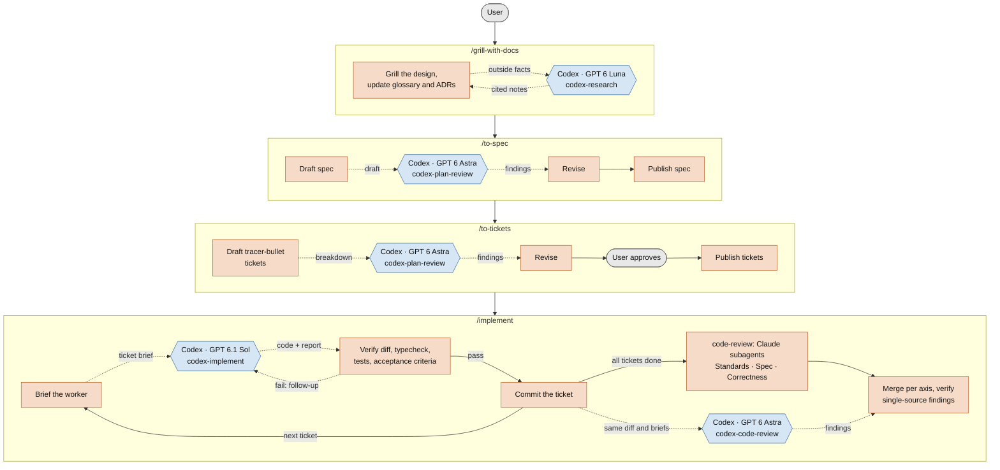

# codex-delegate

**English** | [한국어](docs/README_ko-kr.md)

## Purpose and philosophy

codex-delegate keeps [Matt Pocock's skill](https://github.com/mattpocock/skills) philosophy and puts each agent on the work it does best. It vendors the upstream skills as-is and patches only the five workflow entry points and `code-review`, so they delegate to Codex workers.

> An **unofficial** extension of mattpocock/skills. It is not affiliated with or endorsed by the original author.

### Who does what

| Agent               | Strengths                                                         | Weaknesses                                                       | Role here                                                                                         |
| ------------------- | ----------------------------------------------------------------- | ---------------------------------------------------------------- | ------------------------------------------------------------------------------------------------- |
| Claude (Opus 5.5)   | Understanding user intent, code analysis, design                  | Web search                                                       | **Leader**: interviews the user, writes specs and tickets, briefs workers, verifies their results |
| Codex (GPT 6.1 Sol) | Implementation performance for the cost                           | Often misreads user intent; tends to mark work as done too early | **Implementer**: builds one ticket at a time, test-first                                          |
| Codex (GPT 6 Astra) | Sharp critic and code reviewer; especially strong at computer use |                                                                  | **Adversarial reviewer**: attacks specs and ticket breakdowns before they are published, and reviews code alongside Claude |
| Codex (GPT 6 Luna)  | Cost-effective; can use Codex's excellent web search tool         |                                                                  | **Researcher**: answers outside questions from cited sources, covering the leader's weak spot     |

### Principles

1. **The workflow stays Matt Pocock's.** Same commands, same discipline: grill the design, write the spec, slice tracer-bullet tickets, build test-first. Delegation is added inside those steps, not around them.
2. **The leader owns intent.** Only Claude talks to the user. Workers never have to guess what the user meant: they get self-contained briefs with the ticket, acceptance criteria and agreed test seams.
3. **"Done" is verified, not trusted.** A worker's report is a claim. The leader reads the diff, reruns typechecking and tests, and checks every acceptance criterion before anything is committed.
4. **Critique comes before commitment.** Plans are challenged by a reviewer that didn't write them, while changing them is still cheap.

## Installation

Requirements: Node.js 18.18 or later, git, and the Codex CLI (`npm i -g @openai/codex`, then `codex login`).

```
npx github:starpia-forge/codex-delegate install             # latest on the default branch
npx github:starpia-forge/codex-delegate#v0.2.0 install      # pinned to a tag
```

On Windows, if PowerShell refuses to run `npx` because running scripts is disabled on this system, use `npx.cmd` instead, or allow local scripts once with `Set-ExecutionPolicy -Scope CurrentUser RemoteSigned`.

One command installs the following set into each agent. The set is defined in [`install-manifest.json`](install-manifest.json).

| Agent | Location (user / project) | Skills installed |
|---|---|---|
| Claude Code (leader) | `~/.claude/skills`¹ / `.claude/skills` | everything in `skills/claude/*` (31 skills) |
| Codex (workers) | `~/.codex/skills`¹ / `.agents/skills` | everything in `skills/codex/*`: `tdd`, `codebase-design`, `research` |

¹ When `CLAUDE_CONFIG_DIR` or `CODEX_HOME` is set, user-scope skills go to `$CLAUDE_CONFIG_DIR/skills` or `$CODEX_HOME/skills` instead, matching where each agent looks for them.

A skill both agents use, such as `tdd`, is installed as two separate copies. Each copy is written for its own agent's role, so the delegating and the delegated agent never read the same instructions.

`doctor` runs automatically after installing. Restart Claude Code and Codex to pick up the new skills.

### Commands

```
npx github:starpia-forge/codex-delegate install     [--scope user|project] [--agent <id>] [--force] [--dry-run]
npx github:starpia-forge/codex-delegate uninstall   [--scope user|project] [--agent <id>] [--dry-run]
npx github:starpia-forge/codex-delegate list        [--scope user|project] [--agent <id>]
npx github:starpia-forge/codex-delegate doctor
```

- **Updating**: run `install` again. Skills dropped in the new version are removed automatically.
- **Safety**: every installed skill gets a `.codex-delegate.json` marker file. `install`, `uninstall` and updates only touch skills that carry this marker.
- **Name conflicts**: if a skill with the same name already exists and this tool did not install it (for example, the original mattpocock-skills), installation **stops without changing anything**. Add `--force` to overwrite.
- **Claude Code's built-in `/code-review`**: the installed `code-review` skill replaces it. The built-in review stays available as `/review`, which never runs this skill.
- **Personal over project**: when the same skill name exists in both, Claude Code uses the personal one (`~/.claude/skills`). After a project install, a personal skill with the same name that this tool didn't install hides the project copy.
- **What `doctor` checks**: the Node version, whether Codex is installed and logged in, whether this Codex account offers each role's model and effort, whether the Computer Use plugin (`computer-use@openai-bundled`) is enabled in Codex (warns without failing if disabled or missing), whether the original mattpocock-skills plugin is also installed in Claude Code, and whether personal skills hide skills installed into the current project.

### Preparing a target repository

- Run `/setup-matt-pocock-skills` once in the target repository.
- Add `.scratch/codex/` to `.gitignore`. Each delegated task leaves `prompt.md`, `result.md` and `result.md.log` in this directory.

## Worker configuration

| Role | Model / effort | Sandbox | Used by |
|---|---|---|---|
| `luna` (research) | `gpt-6-luna` / max, web search | read-only | `codex-research` |
| `astra` (adversarial review) | `gpt-6-astra` / medium | read-only | `codex-plan-review`, `codex-code-review` |
| `sol` (implementation) | `gpt-6.1-sol` / medium | workspace-write | `codex-implement` |

Defaults live in [`src/runner/roles.json`](src/runner/roles.json). To change them for yourself, put only the fields you want to override in `~/.codex-delegate/roles.json`. This file survives reinstalls.

```json
{ "sol": { "model": "gpt-6-sol", "effort": "high" } }
```

## Workflow

You type the four commands, one per stage. Orange steps are run by Claude (the leader), blue ones by Codex workers, and grey ones by you. Dotted arrows are delegations and their results.



`/implement-spec` follows the same `/implement` loop for every ticket, with one Claude subagent per ticket working in its own worktree; the leader merges each result into the integration branch and runs one `code-review` over it at the end.

`code-review` has every axis reviewed twice, independently: by a Claude subagent and by Codex, from the same diff and the same briefs. One model's blind spots are caught by the other. The leader merges the two sets of findings per axis, tags each with who found it, and checks any finding only one reviewer reported against the code before accepting it.

Workers never change git state. Commits, branches and merges are handled by the leader or Claude subagents.

## Repository layout

```
bin/cli.mjs                 npx installer
install-manifest.json       per-agent install set
src/skills/                 authored skills (codex-research, codex-plan-review, codex-implement, codex-code-review)
src/runner/                 codex-run.mjs and roles.json (copied into each skill above at build time)
src/codex-skills.json       upstream skills the workers use (copied into skills/codex/)
patches/                    changes against upstream (one per skill)
  claude/                   applied to skills/claude/
  codex/                    applied to skills/codex/
upstream.json               pinned upstream commit
scripts/build.mjs           generates skills/
skills/                     build output; do not edit by hand
  claude/                   every mattpocock skill (5 entry points and code-review patched) + src/skills; Claude Code only
  codex/                    only the upstream skills workers need, patched for the worker role; Codex only
docs/                       translated documentation
```

`skills/` follows the `skills/{scope}/<name>/SKILL.md` convention, so individual skills can also be installed with `gh skill install` or `npx skills add`. In that case you have to match the per-agent set yourself.

## Maintenance

```
node scripts/build.mjs              # regenerate skills/ at the pinned commit
node scripts/build.mjs --ref main   # move to the latest upstream and regenerate
```

- **When a patch no longer applies**: the build fails and leaves `skills/` untouched. Update that patch against the new upstream and run again. Patch paths are relative to upstream's `skills/` directory, e.g. `a/engineering/<skill>/SKILL.md`.
- **How skills are sorted**: every upstream skill goes to `claude/`. The upstream skills listed in `src/codex-skills.json` are also copied, separately, to `codex/`. Each copy is built from a clean upstream checkout with only its own `patches/<agent>/` applied, so a patch for one agent never changes the other agent's copy. The build fails if `patches/codex/` touches a skill not listed in `src/codex-skills.json`.
- **Adding a worker skill**: add its name to `src/codex-skills.json` and rebuild. It is then installed into Codex automatically, since the manifest installs `codex/*`. If its instructions assume the leader's role (talking to the user, spawning agents, writing files), add a patch under `patches/codex/`.
- **Releasing**: bump `version` in `package.json`, commit including `skills/`, and tag with the same version. The marker files record this version.

## Known limitations

- **git ownership errors in the Windows sandbox**: the sandbox runs as a separate OS user, so git rejects the repository as "dubious ownership". `codex-run.mjs` works around this by setting `safe.directory=*` for that process only.
- **No network**: `sol` and `astra` run without network access and cannot read the issue tracker. The delegation skills therefore put the ticket and spec text directly into the prompt.
- **Bash time limit**: foreground Bash commands time out after 10 minutes, so `luna`, `sol` and code review by `astra` run in the background.

## License

[MIT](LICENSE). The bundled upstream skills (mattpocock/skills) are also MIT-licensed; their notice is in [`skills/THIRD_PARTY_LICENSE-mattpocock-skills`](skills/THIRD_PARTY_LICENSE-mattpocock-skills).
