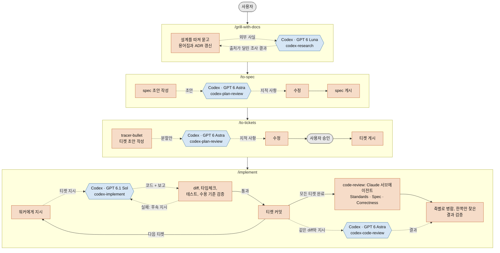

# codex-delegate

[English](../README.md) | **한국어**

## 목적과 철학

codex-delegate는 [Matt Pocock의 스킬](https://github.com/mattpocock/skills) 철학을 그대로 따르면서, 각 에이전트가 가장 잘하는 일을 맡도록 합니다. 원본 스킬은 그대로 가져오고, 워크플로우 진입점 스킬 5개와 `code-review`에만 패치를 적용해 Codex 워커에게 위임하게 만들었습니다.

> mattpocock/skills를 기반으로 한 **비공식** 확장입니다. 원작자와 관련이 없으며, 원작자가 승인하지 않았습니다.

### 누가 무엇을 하는가

| 에이전트            | 강점                                                     | 약점                                                         | 이 저장소에서의 역할                                                                       |
| ------------------- | -------------------------------------------------------- | ------------------------------------------------------------ | ------------------------------------------------------------------------------------------ |
| Claude (Opus 5.5)   | 사용자 의도 파악, 코드 분석, 설계                        | 웹 검색                                                      | **Leader**: 사용자 인터뷰, spec과 티켓 작성, 워커에게 지시, 워커 결과 검증                 |
| Codex (GPT 6.1 Sol) | 비용 대비 구현 성능                                      | 사용자 의도를 잘못 파악하는 경우가 많고, 작업을 일찍 완료 처리하는 경향 | **구현**: 티켓 하나씩, 테스트를 먼저 작성하며 구현                                         |
| Codex (GPT 6 Astra) | 날카로운 비판자이자 코드 리뷰어. 특히 computer use에 강함 |                                                              | **공격적 검토**: spec과 티켓 분할안을 게시하기 전에 공격하고, Claude와 함께 코드 리뷰. **Computer use**: Leader 대신 데스크톱 앱 조작 |
| Codex (GPT 6 Luna)  | 가성비가 좋고, Codex의 훌륭한 웹 검색 도구를 사용할 수 있음 |                                                              | **조사**: 외부 질문에 출처를 달아 답하며, Leader의 약점을 보완                             |

### 원칙

1. **워크플로우는 Matt Pocock의 것을 유지합니다.** 같은 명령, 같은 규율로 진행합니다. 설계를 끝까지 따져 묻고, spec을 쓰고, tracer-bullet 티켓으로 나누고, 테스트를 먼저 작성하며 구현합니다. 위임은 이 단계들 바깥이 아니라 안에 덧붙입니다.
2. **의도는 Leader가 책임집니다.** 사용자와 대화하는 것은 Claude뿐입니다. 워커는 사용자의 뜻을 추측할 필요가 없습니다. 티켓, 수용 기준, 합의된 테스트 지점이 모두 담긴 지시를 받습니다.
3. **"완료"는 믿지 않고 검증합니다.** 워커의 보고는 주장일 뿐입니다. Leader가 diff를 읽고, 타입체크와 테스트를 다시 돌리고, 수용 기준을 하나씩 확인한 뒤에야 커밋합니다.
4. **확정하기 전에 비판받습니다.** 계획은 그 계획을 쓰지 않은 검토자가 공격합니다. 아직 바꾸는 비용이 적을 때 합니다.

## 설치

필요한 것: Node.js 18.18 이상, git, Codex CLI(`npm i -g @openai/codex` 후 `codex login`).

```
npx github:starpia-forge/codex-delegate install             # 기본 브랜치 최신
npx github:starpia-forge/codex-delegate#v0.2.0 install      # 태그 고정
```

Windows PowerShell에서 "이 시스템에서 스크립트를 실행할 수 없으므로" 오류로 `npx`가 실행되지 않으면 `npx.cmd`를 쓰거나, `Set-ExecutionPolicy -Scope CurrentUser RemoteSigned`로 로컬 스크립트 실행을 한 번 허용합니다.

명령 하나로 각 에이전트에 아래 구성이 설치됩니다. 구성은 [`install-manifest.json`](../install-manifest.json)에 정의되어 있습니다.

| 에이전트 | 설치 위치 (user / project) | 설치되는 스킬 |
|---|---|---|
| Claude Code (Leader) | `~/.claude/skills`¹ / `.claude/skills` | `skills/claude/*` 전부 (32개) |
| Codex (워커) | `~/.codex/skills`¹ / `.agents/skills` | `skills/codex/*` 전부: `tdd`, `codebase-design`, `research` |

¹ `CLAUDE_CONFIG_DIR`나 `CODEX_HOME`이 설정되어 있으면 user 범위 스킬은 각 에이전트가 스킬을 찾는 위치인 `$CLAUDE_CONFIG_DIR/skills`, `$CODEX_HOME/skills`에 설치됩니다.

`tdd`처럼 두 에이전트가 모두 쓰는 스킬은 별개의 사본 두 개로 설치됩니다. 각 사본은 해당 에이전트의 역할에 맞게 작성되므로, 위임하는 에이전트와 위임받는 에이전트가 같은 지침을 읽는 일이 없습니다.

설치가 끝나면 `doctor`가 자동으로 실행됩니다. Claude Code와 Codex를 재시작해야 새 스킬이 반영됩니다.

### 명령

```
npx github:starpia-forge/codex-delegate install     [--scope user|project] [--agent <id>] [--force] [--dry-run]
npx github:starpia-forge/codex-delegate uninstall   [--scope user|project] [--agent <id>] [--dry-run]
npx github:starpia-forge/codex-delegate list        [--scope user|project] [--agent <id>]
npx github:starpia-forge/codex-delegate doctor
```

- **업데이트**: `install`을 다시 실행합니다. 새 버전에서 빠진 스킬은 자동으로 제거됩니다.
- **안전 장치**: 설치한 스킬마다 `.codex-delegate.json` 표시 파일을 남깁니다. `install`, `uninstall`, 업데이트는 이 표시가 있는 스킬만 건드립니다.
- **이름 충돌**: 같은 이름의 스킬이 이미 있고 이 도구가 설치한 것이 아니면(예: 원본 mattpocock-skills), **아무것도 바꾸지 않고 중단**합니다. 덮어쓰려면 `--force`를 붙입니다.
- **Claude Code 내장 `/code-review`**: 설치한 `code-review` 스킬이 내장 스킬을 대체합니다. 내장 리뷰는 `/review`로 계속 쓸 수 있고, `/review`는 이 스킬을 실행하지 않습니다.
- **개인이 프로젝트보다 우선**: 같은 이름의 스킬이 양쪽에 있으면 Claude Code는 개인 스킬(`~/.claude/skills`)을 씁니다. 프로젝트 범위로 설치했더라도, 이 도구가 설치하지 않은 같은 이름의 개인 스킬이 있으면 프로젝트 쪽이 가려집니다.
- **`doctor` 점검 항목**: Node 버전, Codex 설치와 로그인 상태, 역할별 모델과 effort를 현재 Codex 계정에서 쓸 수 있는지, Codex의 Computer Use 플러그인(`computer-use@openai-bundled`)이 활성화되어 있는지(비활성화되었거나 없으면 실패 없이 경고), Claude Code에 원본 mattpocock-skills 플러그인이 중복 설치되어 있는지, 개인 스킬이 현재 프로젝트에 설치한 스킬을 가리는지.

### 대상 저장소 준비

- 대상 저장소에서 `/setup-matt-pocock-skills`를 한 번 실행합니다.
- `.gitignore`에 `.scratch/codex/`를 추가합니다. 위임 작업마다 이 디렉터리에 `prompt.md`, `result.md`, `result.md.log`가 남습니다.

## 워커 설정

| 역할 | 모델 / effort | sandbox | 사용하는 스킬 |
|---|---|---|---|
| `luna` (조사) | `gpt-6-luna` / max, 웹 검색 | read-only | `codex-research` |
| `astra` (공격적 검토) | `gpt-6-astra` / medium | read-only | `codex-plan-review`, `codex-code-review` |
| `sol` (구현) | `gpt-6.1-sol` / medium | workspace-write | `codex-implement` |
| `astra-cu` (computer use) | `gpt-6-astra` / medium | 없음: 승인과 sandbox 우회 | `codex-computer-use` |

기본값은 [`src/runner/roles.json`](../src/runner/roles.json)에 있습니다. 사용자별로 바꾸려면 `~/.codex-delegate/roles.json`에 바꿀 필드만 적습니다. 이 파일은 재설치해도 유지됩니다.

```json
{ "sol": { "model": "gpt-6-sol", "effort": "high" } }
```

### Computer use (`astra-cu`)

`codex-computer-use`는 데스크톱 앱 작업(Windows 앱 클릭, 대화상자에 입력, 앱 화면 확인)을 Codex 워커에게 맡깁니다. 웹사이트는 대상이 아니며 브라우저 도구가 계속 맡습니다. 워커는 마지막 스크린샷 `final.png`를 저장하고, Leader는 이 스크린샷을 완료 기준과 대조한 뒤에야 작업을 완료로 봅니다.

필요한 것:

- Codex 데스크톱 앱이 설치되어 있고, 스킬이 실행되는 동안 **켜져 있어야** 합니다(워커가 이 앱을 통해 화면에 접근합니다. 앱이 꺼져 있으면 `Computer Use native pipe is unavailable`로 실패합니다).
- Codex에서 Computer Use 플러그인이 활성화되어 있어야 합니다(꺼져 있으면 `doctor`가 경고합니다).

**sandbox가 없는 이유.** `codex exec`에서는 Computer Use 플러그인이 앱마다 승인을 요청하는데, 응답할 사람이 없어 요청이 거부됩니다(`Computer Use was not approved to use <app>`). 그래서 `astra-cu`는 Codex를 `--dangerously-bypass-approvals-and-sandbox`로 실행합니다. 이 옵션은 승인뿐 아니라 셸 sandbox도 끕니다. 워커는 어떤 명령이든 실행하고, 사용자 계정이 쓸 수 있는 곳 어디에나 쓰고, 네트워크를 쓸 수 있으며, 데스크톱의 어떤 앱이든 조작할 수 있습니다. 끄려면 `~/.codex-delegate/roles.json`에 `{ "astra-cu": { "dangerouslyBypassApprovalsAndSandbox": false } }`를 넣습니다. 그러면 computer use는 동작하지 않습니다.

**워커는 한 번에 하나.** 데스크톱은 하나이므로, `astra-cu` 워커가 실행되는 동안 runner가 사용자별 잠금 디렉터리 `~/.codex-delegate/computer-use.lock/`을 잡습니다. 모든 Claude 세션과 worktree에 공통으로 적용됩니다. 두 번째 실행은 Codex를 시작하지 않고 바로 종료 코드 75("computer use busy")로 끝납니다. 잠금에는 runner와 Codex 프로세스의 PID가 기록되고, 둘 다 종료되면 자동으로 회수됩니다. 남는 위험:

- runner가 강제 종료되면(예: 작업 관리자에서) 셸의 손자 프로세스가 기록된 두 PID보다 오래 살아남아, 새 워커가 잠금을 잡은 뒤에도 데스크톱을 계속 조작할 수 있습니다.
- 회수된 잠금은 삭제되지 않고 `computer-use.lock.stale-<hash>`로 이름이 바뀌므로 `~/.codex-delegate/`에 이런 사본이 쌓일 수 있습니다. 워커가 실행 중이 아닐 때 지우면 됩니다.
- 불완전한 잠금(runner가 Codex PID를 기록하기 전에 종료됨)은 계속 busy로 취급됩니다. 실행 중인 워커가 없는 것을 확인한 뒤 `~/.codex-delegate/computer-use.lock/`을 직접 지워야 합니다.

## 워크플로우

사용자는 단계마다 명령 하나씩, 네 개의 명령을 입력합니다. 주황색 단계는 Claude(Leader)가, 파란색 단계는 Codex 워커가, 회색 단계는 사용자가 수행합니다. 점선 화살표는 위임과 그 결과입니다.



`/implement-spec`은 모든 티켓에 같은 `/implement` 흐름을 적용합니다. 티켓마다 Claude 서브에이전트가 자기 worktree에서 작업하고, Leader가 각 결과를 통합 브랜치에 병합한 뒤, 마지막에 통합 브랜치 전체에 `code-review`를 한 번 실행합니다.

`code-review`는 모든 축을 Claude 서브에이전트와 Codex가 같은 diff와 같은 지시로 각자 독립적으로 검토합니다. 한 모델이 놓친 부분을 다른 모델이 잡기 위해서입니다. Leader는 두 결과를 축별로 합치고 누가 찾았는지 표시하며, 한쪽만 찾은 결과는 코드와 대조해 확인한 뒤에 채택합니다.

워커는 git 상태를 바꾸지 않습니다. 커밋, 브랜치, 병합은 Leader나 Claude 서브에이전트가 맡습니다.

## 저장소 구조

```
bin/cli.mjs                 npx 설치 도구
install-manifest.json       에이전트별 설치 구성
src/skills/                 직접 작성한 스킬 (codex-research, codex-plan-review, codex-implement, codex-code-review, codex-computer-use)
src/runner/                 codex-run.mjs와 roles.json (빌드 시 위 스킬 각각에 복사됨)
src/codex-skills.json       워커가 쓰는 원본 스킬 목록 (skills/codex/로 복사됨)
patches/                    원본 대비 변경분 (스킬당 1개)
  claude/                   skills/claude/에 적용
  codex/                    skills/codex/에 적용
upstream.json               고정된 원본 커밋
scripts/build.mjs           skills/ 생성
skills/                     빌드 산출물. 직접 수정하지 말 것
  claude/                   mattpocock 기본 스킬 전부(진입점 5개와 code-review는 패치본) + src/skills. Claude Code 전용
  codex/                    워커에게 필요한 원본 스킬만, 워커 역할에 맞게 패치. Codex 전용
docs/                       번역 문서
```

`skills/`는 `skills/{scope}/<name>/SKILL.md` 규칙을 따르므로 `gh skill install`이나 `npx skills add`로도 개별 설치할 수 있습니다. 다만 그 경우에는 에이전트별 구성을 사용자가 직접 맞춰야 합니다.

## 유지보수

```
node scripts/build.mjs              # 고정된 커밋으로 skills/ 다시 생성
node scripts/build.mjs --ref main   # 원본을 최신으로 올리고 다시 생성
```

- **패치가 적용되지 않을 때**: `skills/`는 그대로 두고 실패합니다. 해당 패치를 새 원본에 맞게 고친 뒤 다시 실행합니다. 패치 경로는 `a/engineering/<skill>/SKILL.md`처럼 원본 `skills/` 디렉터리 기준입니다.
- **스킬 분류 규칙**: 원본 스킬은 모두 `claude/`로 갑니다. `src/codex-skills.json`에 있는 원본 스킬은 별도로 `codex/`에도 복사됩니다. 각 사본은 깨끗한 원본에 자기 `patches/<agent>/`만 적용해 만들므로, 한쪽 에이전트용 패치가 다른 쪽 사본을 바꾸는 일은 없습니다. `patches/codex/`가 `src/codex-skills.json`에 없는 스킬을 건드리면 빌드가 실패합니다.
- **워커 스킬 추가**: `src/codex-skills.json`에 이름을 넣고 다시 빌드하면 Codex 설치 대상에도 자동으로 포함됩니다. 매니페스트는 `codex/*`를 설치합니다. 지침이 Leader 역할(사용자와 대화, 에이전트 생성, 파일 작성)을 전제한다면 `patches/codex/`에 패치를 추가합니다.
- **릴리스 절차**: `package.json`의 `version`을 올리고, `skills/`를 포함해 커밋한 뒤 같은 버전으로 태그를 붙입니다. 표시 파일에 이 버전이 기록됩니다.

## 알려진 제약

- **Windows sandbox의 git 소유권 오류**: sandbox가 별도 OS 사용자로 실행되어 git이 "dubious ownership"으로 저장소를 거부합니다. `codex-run.mjs`가 해당 프로세스에만 `safe.directory=*`를 넣어 우회합니다.
- **네트워크 차단**: `sol`과 `astra`는 네트워크가 막혀 있어서 이슈 트래커를 직접 읽지 못합니다. 그래서 위임 스킬이 티켓과 spec 본문을 프롬프트에 직접 담습니다.
- **Windows 10의 computer use**: Windows 10(빌드 19045)에서 Codex Computer Use의 스크린샷 시간 초과와 클릭 위치 오류가 GitHub 이슈로 보고되어 있습니다. 이 환경에서는 실패하는 시도가 더 많을 수 있습니다.
- **Bash 시간 제한**: Bash의 foreground 시간 제한은 10분입니다. 그래서 `luna`, `sol`, `astra-cu`, 그리고 `astra`의 코드 리뷰는 백그라운드로 실행합니다.

## 라이선스

[MIT](../LICENSE). 포함된 원본 스킬(mattpocock/skills)도 MIT 라이선스이며, 고지문은 [`skills/THIRD_PARTY_LICENSE-mattpocock-skills`](../skills/THIRD_PARTY_LICENSE-mattpocock-skills)에 있습니다.
